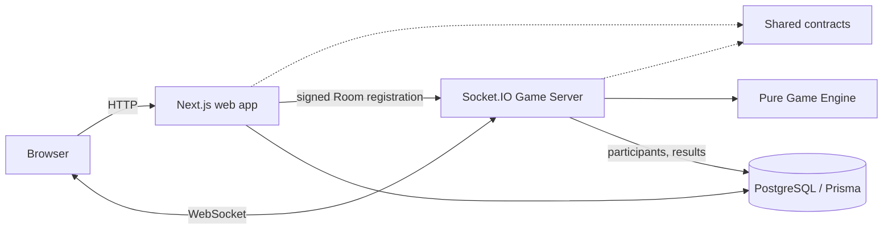

<div align="center">
  

  <h1>AptiQuiz</h1>
  <p><strong>Race the clock. Climb the room.</strong></p>
  <p>Live aptitude competition for students preparing for placements.</p>

  <p>
    <a href="LICENSE"></a>
    <a href="Apti-App/package.json"></a>
    <a href="Apti-App/package.json"></a>
    <a href="#project-status"></a>
  </p>

  <p>
    <a href="docs/handbook/README.md">Handbook</a> ·
    <a href="#quick-start">Quick start</a> ·
    <a href="Architecture.md">Architecture</a> ·
    <a href="https://github.com/codesuke/AptiQuiz/issues">Roadmap &amp; issues</a> ·
    <a href="CONTRIBUTING.md">Contributing</a>
  </p>

  <p>
    <a href="https://nextjs.org/"></a>
    <a href="https://react.dev/"></a>
    <a href="https://www.typescriptlang.org/"></a>
    <a href="https://tailwindcss.com/"></a>
    <a href="https://socket.io/"></a>
    <a href="https://www.postgresql.org/"></a>
    <a href="https://www.prisma.io/"></a>
    <a href="https://pnpm.io/"></a>
  </p>
</div>

## About

AptiQuiz turns solitary placement practice into a live competition. Up to 50 students join a shared Room with a short code, see the same aptitude Question at the same moment, answer against a server-controlled clock, and watch the Leaderboard move after every Round.

Hosts write reusable Question Sets (text, options, correct answer, topic, difficulty, and an optional image or data table) and share a Join Code or QR code. Players join from a phone or laptop with just a display name. The Game Server is the referee: it opens and closes every Round, accepts or rejects every Answer, and calculates every score. Signed-in players' results feed a weekly College League.

**Try it:** [aptiquiz.codesuke.in](https://aptiquiz.codesuke.in). Built for **hackathon problem statement 3 — AptiQuiz**; see [the official brief and build specification](PS.md).

## Project status

**Playable MVP, deployed.** A complete multiplayer Match runs end to end on the [deployed servers](#deployment), and one 50-Participant Match passed there on 2026-10-10 (see [50-Participant proof](#50-participant-proof)). [Build memory](docs/build-memory.yaml) records verified delivery history.

How each requirement of the brief is met:

| Brief requirement | How AptiQuiz meets it |
| --- | --- |
| 1. Question authoring | `/question-sets`: create, edit, and reorder Questions with 2–6 options, a correct answer, a topic (Quantitative, Logical, Verbal, and Data Interpretation are suggested), Easy/Medium/Hard difficulty, and an optional image URL or data table. Sets are reused: each Room snapshots its set, so later edits never change a running Match. Five starter sets are seeded. |
| 2. Rooms | `/host` creates a Room with a six-character Join Code (no look-alike characters such as `0/O` or `1/I`), a join link, a QR code, and Copy/Share buttons. Players join at `/join` with a display name, no account needed. The Lobby roster updates live; only the Host can start. |
| 3. Live play | Every Participant receives the Question with the same server `startsAt` and deadline and sees a countdown derived from server time. A Round closes at the 30 s deadline or as soon as every connected player has answered; the correct answer and the Round's scores are then revealed. |
| 4. Speed and accuracy scoring | Correct = 500–1000 points, faster scores more; wrong or no answer = 0 (no negative marking, see [Scoring](#scoring-and-timing)). Players see the exact rule, with the server's own values, in the Lobby before the Match starts. |
| 5. Live leaderboard and results | After each Question: ranks, totals, and ▲/▼ movement (who climbed, who dropped). At the end: a podium plus each player's accuracy, average response time, and topic-by-topic correct/total. |
| 6. College league | Each Room belongs to the Host's Home College. `/league` shows the top 10 players and top 10 Colleges for the current week. |
| Server is the referee | Server receipt time decides every Answer; browser clocks are display-only. Scores are computed only in the pure Game Engine on the server. |
| Fair under network delay | Server-measured, capped latency compensation plus 100 ms score buckets. [Plain-words explanation](#network-delay-in-plain-words). |
| Reconnection | A refresh or dropped connection resumes the same Participant, score, locked Answer, option order, and deadline, without notifying anyone else. See [Reconnection](#reconnection). |
| Cheating resistance | Per-player option shuffle with opaque option ids, no correct answer before the reveal, late and duplicate Answers rejected, and more. See [Cheating resistance](#cheating-resistance). |
| Works with 50 players | `pnpm simulate` plays a full Match with 50 virtual players, and it passed on the deployed servers. See [50-Participant proof](#50-participant-proof). |

Beyond the brief: reduced-motion support, screen-reader live regions, and text labels that never rely on colour alone. `pnpm simulate:bots` fills your own Room with bots for practice or a projector demo.

## Quick start

### Prerequisites

- Node.js **22.18+**; Node.js 24 is recommended by the project setup.
- pnpm **11**; the workspace pins `11.24.0`.
- PostgreSQL for account flows, database migrations, and database browsing.

### Install and run

```bash
git clone https://github.com/codesuke/AptiQuiz.git
cd AptiQuiz/Apti-App
cp .env.example .env
pnpm install
```

All workspace commands run from **`Apti-App/`**. Installation generates the Prisma client. Create your local PostgreSQL database, update `DATABASE_URL` in `.env`, and configure the authentication variables needed by account flows before starting the application. Then run:

```bash
pnpm db:migrate
pnpm --filter @aptiquiz/database db:seed   # approved Colleges and starter Question Sets; safe to re-run
pnpm dev
```

| Service | Local URL |
| --- | --- |
| Web application | http://localhost:3000 |
| Web health | http://localhost:3000/api/health |
| Game Server health | http://localhost:3001/health |

The [environment template](Apti-App/.env.example) documents server ports, browser URLs, and reserved authentication settings. The Game Server reads `Apti-App/.env` and refuses to start unless `GAME_SERVER_SECRET` contains at least 32 characters; generate one with `openssl rand -base64 32`.

Google sign-in is optional. To enable it, create an OAuth client of type "Web application" in the Google Cloud console, add `http://localhost:3000/api/auth/callback/google` as an authorized redirect URI, and set `GOOGLE_CLIENT_ID` and `GOOGLE_CLIENT_SECRET` in `.env`. When either value is empty, the sign-in and sign-up pages show only the email form. For production, also add `https://aptiquiz.codesuke.in/api/auth/callback/google`; see [Deployment](#deployment).

### Prepare Google SMTP for transactional email

The project includes a Gmail/Nodemailer sender configured through `GMAIL_USER` and `GMAIL_APP_PASSWORD`. Better Auth sends verification and password-reset email through this sender when both values are set. Without them, development and test write the email to the server log, and other environments refuse to send.

1. Use a dedicated Gmail or Google Workspace sender mailbox.
2. Turn on [Google 2-Step Verification](https://support.google.com/mail/answer/185839).
3. Create an [App Password](https://myaccount.google.com/apppasswords) named `AptiQuiz SMTP` and copy the generated 16-character value.
4. Set the values in `Apti-App/.env`—never use the account's normal password or commit the file:

   ```env
   GMAIL_USER=aptiquiz.notifications@gmail.com
   GMAIL_APP_PASSWORD=your-16-character-google-app-password
   ```

Google may not offer App Passwords for Workspace accounts where an administrator disables them, accounts using Advanced Protection, or accounts configured only with security keys. Changing the Google account password revokes existing App Passwords; create and deploy a replacement when that happens. See [Google's App Password guidance](https://support.google.com/accounts/answer/185833).

### Verify the workspace

```bash
pnpm check
```

This runs formatting/lint checks, TypeScript checks, behavior tests, and production builds. Individual commands are also available:

| Command | Purpose |
| --- | --- |
| `pnpm lint` | Biome formatting and lint checks |
| `pnpm typecheck` | Strict TypeScript checks |
| `pnpm test` | Vitest behavior tests |
| `pnpm build` | Production builds for apps and packages |
| `pnpm simulate` | Plays a starter Room with up to 50 virtual Participants through every Question |
| `pnpm simulate:bots` | Adds bots to a Room you host; see Bots in your own Room |

Run `pnpm simulate` in another terminal while `pnpm dev` is running.

The simulator needs a signed-in Host with a Home College. Pass that Host's session as a `Cookie` header value. Treat it as a secret: the simulator never prints it.

| Variable | Default | Purpose |
| --- | --- | --- |
| `SIMULATOR_HOST_COOKIE` | none | Host session. The simulator creates a starter Room and a Host Socket Ticket through the web app. |
| `SIMULATOR_WEB_URL` | `http://localhost:3000` | Web application that creates the Room. |
| `SIMULATOR_URL` | `http://localhost:3001` | Game Server under test. |
| `SIMULATED_PLAYERS` | `50` | Participants to join, 1 to 50. A larger value fails before any connection. |
| `SIMULATOR_ROOM_ID`, `SIMULATOR_HOST_TICKET` | none | Alternative to the cookie: a fresh starter Room and a Host ticket made beforehand. Set both. A ticket lives 60 seconds. |

The report is JSON. `connectedSockets` counts open sockets and `joinedParticipants` counts accepted joins; `lobbyParticipants` is read back from the public Lobby. `latencyMs` metrics are client-observed acknowledgement round trips in milliseconds (`timePingAck`, `roomJoinAck`, `roomHostAck`) with sample counts, p50, p95, and max. The `match` block counts accepted Answers, deliberate new-key duplicates rejected, exact-key replays, late Answers rejected (by error code), Questions completed, payloads scanned for pre-reveal disclosure, and the Game Server timing constants. A late Answer sent at the deadline is rejected as `answer_too_late` or, when the deadline timer has already closed the Round, as `round_not_open`; both count as rejected. `hostCommandToRoundState` is the time from the Host start command until each viewer receives the first open Round; later Questions open automatically after each reveal, so they have no command to time. `lastAnswerAckToReveal` is the time from the last Answer acknowledgement to the reveal, for early-closed Rounds. A full run lasts about one Round duration, because the first Round stays open for the late Answer check.

The process exits nonzero when any setup, connection, join, Lobby, scoring, secrecy, or timeout check fails; `errors` names each broken check. During the second Question a subset of Participants disconnects and resumes with a Resume Token; `resumes` counts attempts and successes (same identity, score, Answer state, option order, and deadline). `leaderboardsConverged` counts Rounds whose ordered Leaderboard matched across the Host and every Participant and equalled the revealed Round points. `finalResultsVerified` counts saved results that match those totals. Resume Tokens are scrubbed from all output.

### 50-Participant proof

One full Match with 50 virtual Participants was run against the deployed servers on **2026-10-10 at 14:56 UTC**. The simulator process exited 0 and its report showed no errors.

Command (the Host session is a secret and is not recorded here):

```bash
cd Apti-App
SIMULATOR_WEB_URL=https://aptiquiz.codesuke.in \
SIMULATOR_URL=https://game.aptiquiz.codesuke.in \
SIMULATOR_HOST_COOKIE='<Cookie header of a signed-in Host with a Home College>' \
pnpm simulate
```

| Item | Value |
| --- | --- |
| Runner | AMD Ryzen 7 5800H, 16 logical CPUs, 13 GiB RAM, WSL2 (Linux 6.18), Node.js 24.14; reached the servers over the public internet |
| Game Server and web app | Dokploy deployment at `game.aptiquiz.codesuke.in` and `aptiquiz.codesuke.in`. The server hardware is not visible to the runner and is not recorded. |
| Simulator code | commit `12a9eaa` |
| Question Set | Seeded starter set, 3 Questions |
| Round timing | 30,000 ms Round; 100 ms delay-compensation cap; 100 ms score bucket |
| Host | A throwaway account made for this run |

Counts from the report: 50 sockets connected, 50 Participants joined, 50 distinct identities in the public Lobby; 3 Questions completed; 140 Answers accepted (30 of them wrong); 10 unanswered Participant-Rounds; 30 new-key duplicates rejected; 30 exact-key replays returned the first result; 10 late Answers rejected, all as `round_not_open` (the deadline timer had already closed the Round); 15 of 15 resumes restored identity, score, Answer state, option order, and deadline; Leaderboards were identical for all viewers after 3 of 3 Rounds; 50 saved results matched the revealed Round points; 2,269 pre-reveal payloads were scanned and none disclosed a correct option, correctness, explanation, or points. A Participant's Host command was refused as `not_room_host`. The run took about 33 s.

Client-observed latency in milliseconds (the time from sending a command to its acknowledgement or event, measured in the simulator process, including the internet round trip):

| Metric | Samples | p50 | p95 | max |
| --- | ---: | ---: | ---: | ---: |
| `timePingAck` | 50 | 35.6 | 56.5 | 86.7 |
| `roomJoinAck` | 50 | 101.7 | 199.8 | 204.2 |
| `roundAnswerAck` | 210 | 30.0 | 51.3 | 52.6 |
| `roomResumeAck` | 15 | 25.4 | 35.5 | 35.5 |
| `hostCommandToRoundState` | 153 | 35.0 | 42.5 | 42.9 |
| `lastAnswerAckToReveal` | 102 | 42.9 | 51.9 | 322.5 |
| `roomAdvanceAck` | 3 | 38.4 | 141.0 | 141.0 |

This run predates automatic advance: the Host still sent `room:advance` after each reveal, which `roomAdvanceAck` measures. The simulator now waits for the server to open each next Question by itself, and checks the Host-only rule by sending `room:start` from a Participant.

This is one run of one Room. It shows that a 50-Participant Match completes correctly on the deployed Game Server from a single runner. It does not show capacity for many Rooms, other networks, or browsers. The simulator sets no latency pass threshold.

### Bots in your own Room

To play against bots on the deployed site, host a Room in the browser, then run:

```bash
cd Apti-App
SIMULATOR_JOIN_CODE=ABC234 SIMULATED_PLAYERS=20 pnpm simulate:bots
```

No sign-in or cookie is needed: bots join as Guests, so the Host stays in your hands. Join before you press Start. The bots print `[bots] N bots joined`, then wait for you to run the match. Each bot answers every Round after a random delay, and leaves some Rounds unanswered. You can play alongside them.

| Variable | Default | Purpose |
| --- | --- | --- |
| `SIMULATOR_JOIN_CODE` | none | Join Code of a Room in its Lobby (required). |
| `SIMULATOR_URL` | `https://game.aptiquiz.codesuke.in` | Game Server to join. Use `http://localhost:3001` locally. |
| `SIMULATED_PLAYERS` | `10` | Bots to add, 1 to 50, within the Room's 50-Participant limit. |
| `BOT_MAX_ANSWER_DELAY_MS` | `8000` | Longest wait before a bot answers. |
| `BOT_SKIP_PERCENT` | `10` | Share of bot Rounds left unanswered. |
| `BOT_WAIT_MS` | `900000` | How long to wait for you to finish the match. |

When the match ends, the bots check what they saw and print a JSON report (exit 0 on success, 1 otherwise). Each bot checks that its result matches the option it sent, that all bots saw the same scores and ordered Leaderboard after every Round and that the Leaderboard totals equal the revealed points, and that the saved results match. They also check that nothing disclosed the correct option before the reveal. `otherParticipants` counts the people in the Room besides the bots. Bots do not know the correct answers, so they pick options at random.

A run on 2026-10-10 against the deployed servers, with a script standing in for the Host, passed with 50 bots: 139 Answers accepted, 11 skipped, 3 of 3 Leaderboards identical across bots, 50 saved results matched, and 2,114 pre-reveal payloads showed no disclosure.

### Database commands

```bash
pnpm db:generate
pnpm db:migrate
pnpm db:studio
```

Migrations and Prisma Studio need a reachable PostgreSQL database and a valid `DATABASE_URL`. The schema lives in [packages/database](Apti-App/packages/database/prisma/schema.prisma).

## Deployment

AptiQuiz runs on Dokploy as two applications built from `Apti-App/Dockerfile` (see the [deployment guides](docs/guide/README.md) and [ADR 0008](docs/ADR/0008-dokploy-deployment-redis-deferred.md)).

| Service | URL | Dockerfile target | Health check |
| --- | --- | --- | --- |
| Web app | `https://aptiquiz.codesuke.in` | `web` | `GET /api/health` |
| Game Server | `https://game.aptiquiz.codesuke.in` | `game-server` | `GET /health` |

- **TLS and WebSocket:** Traefik in Dokploy terminates TLS and proxies WebSocket connections.
- **CORS:** the Game Server allows only `GAME_SERVER_ORIGIN`, set to `https://aptiquiz.codesuke.in` in production.
- **Migrations:** the `web` container runs `prisma migrate deploy` before it starts. The `game-server` container never migrates.
- **Seed:** run `pnpm --filter @aptiquiz/database db:seed` from `Apti-App/` against the production `DATABASE_URL` to load the approved Colleges and the starter Question Set. It is safe to run again.
- **Configuration names:** values come from Dokploy environment settings and are never committed. See `Apti-App/.env.example` for `DATABASE_URL`, `GAME_SERVER_SECRET`, `GAME_SERVER_ORIGIN`, `NEXT_PUBLIC_GAME_SERVER_URL`, `NEXT_PUBLIC_APP_URL`, `BETTER_AUTH_URL`, `BETTER_AUTH_SECRET`, `GOOGLE_CLIENT_ID`, `GOOGLE_CLIENT_SECRET`, `ADMIN_EMAILS`, `GMAIL_USER`, and `GMAIL_APP_PASSWORD`.
- **Production auth:** `BETTER_AUTH_URL` is the production web URL, and the Google OAuth client lists `https://aptiquiz.codesuke.in/api/auth/callback/google`. Verification and reset emails link to the production domain.
- **Redis:** provisioned but unused in the one-process MVP.
- **Restarts:** live Rooms are held in memory and are lost when the Game Server restarts. Avoid a redeploy during a live demo.
- **Result of the 50-Participant run:** see the [50-Participant proof](#50-participant-proof).

Checked on 2026-10-10: both health endpoints respond over HTTPS; a WebSocket-only handshake from the web origin connects, and a headless Chrome page load shows the Game Server online; the Game Server CORS policy only ever grants the web origin, so browsers on other origins block responses; the web container applies a new migration at start (deploy of `3068edd` applied `20261010152001_match_result_completed_at_index`, seen in the container log); a pattern scan of tracked files and history found no secret value; the owner reported that production Google sign-in and email links work. Details and limits: [PRD #11 archive](docs/Specs-Completed/11-dokploy-deployment/PRD.md).

## Architecture

The web interface and realtime runtime share validated contracts and deterministic game rules. A separate Game Server owns timing; the browser is not authoritative for answers or scores.



Solid arrows show runtime calls; dashed arrows show shared contract dependencies. The web app owns accounts, authoring, Room creation, and the League; it signs a short-lived registration to hand each new Room to the Game Server. The Game Server owns every live Room in memory, calls the pure Game Engine for every phase change and score, and writes Participants and final results to PostgreSQL.

```text
AptiQuiz/
├── Apti-App/                 # Runnable pnpm / Turborepo workspace
│   ├── apps/
│   │   ├── web/              # Next.js interface and public brand assets
│   │   ├── game-server/      # Authoritative Socket.IO runtime
│   │   └── simulator/        # 50-player Match simulator and practice bots
│   └── packages/
│       ├── contracts/        # Runtime schemas and transport types
│       ├── game-engine/      # Pure phase transitions and scoring
│       ├── socket-ticket/    # Signed, short-lived connection tickets
│       ├── database/         # Prisma schema and PostgreSQL adapter
│       └── typescript-config/
├── design-mocks/             # UI references, prototypes, and logo provenance
├── docs/                     # Architecture decisions and build records
└── AGENTS.md                 # Agent contribution rules
```

Read [Architecture.md](Architecture.md) for implemented interfaces, failure behavior, and deployment plans. Redis remains deferred until measurements justify multiple Game Server processes; Kafka is also deferred.

## Scoring and timing

The Game Server is the only clock that decides an Answer. Players see these rules in the Lobby before the match starts.

### The life of a Match

```text
LOBBY ──Host presses Start──► READY (3 s) ──► QUESTION_OPEN (30 s, or until all answer)
                                  ▲                       │
                                  │                       ▼
                          next Question ◄──── QUESTION_REVEAL (6 s: answer, points, Leaderboard)
                                                          │ after the last Question
                                                          ▼
                                        FINISHED (results saved, final results on every screen)
```

After the Host presses Start, the server runs the whole Match by itself. A 3-second "Get ready" leads into each Question, so nobody's timer starts while they are still reading the previous reveal. The reveal shows the correct answer, each player's own result and points, and the Leaderboard with movement for 6 seconds. Then the next Question begins. After the last Question the server saves every player's result in one database transaction and only then shows the final results.

### Points

- **Correct answer:** `500 + floor(500 × (1 − Effective Response Time ÷ 30 000 ms))`. That is 1000 for an instant answer, about 750 at 15 s, and 500 at the deadline. A correct answer always beats any wrong one, and speed decides between correct ones.
- **Wrong or no answer:** 0 points. We chose no negative marking on purpose: aptitude tests reward attempting, and a penalty would push nervous students to skip instead of practising under time pressure. Speed already separates the strongest players.
- **One Answer per Question.** Only the first accepted Answer counts. Answers cannot be changed.
- **Ranking:** total points (higher first). A tie is broken by the total time taken on correct answers (faster first), then by who joined first, so every player has a distinct rank.
- **Movement:** after each Question, ▲n / ▼n shows how many places each player climbed or dropped since the previous Question.
- **Final results:** accuracy is correct answers ÷ Questions in the Match. Average speed is the mean Effective Response Time over the Questions the player answered. Topic strengths are correct/total for each topic of the set.

### Network delay in plain words

Two students press their answer at the same moment, one on campus Wi-Fi and one on a slow mobile connection. The slow connection's answer reaches the server later, so judged naively the slow student looks slower. AptiQuiz evens this out in three steps:

1. **The server measures each connection itself.** Every 2 seconds it pings each player and times the reply; the browser never reports its own timing, so it cannot lie about it. It keeps the middle value (the median) of the last 5 replies, so one bad spike doesn't count.
2. **It gives back half of that round trip, up to a limit.** Half the round trip is roughly the time the answer spent travelling, so that much is subtracted from the measured time. The credit is capped at 100 ms, the same cap for every player, so a student who deliberately slows their connection can gain at most 0.1 s. That is worth at most about 2 points.
3. **It rounds to 100 ms buckets.** Answers within the same tenth of a second score identically, so tiny network differences never change the result.

The deadline itself is never adjusted. An answer that reaches the server after the deadline is rejected, even if the player's screen still showed time left. Compensation only changes the score of an answer that arrived on time.

All the values live in [`Apti-App/apps/game-server/src/config.ts`](Apti-App/apps/game-server/src/config.ts) and are sent to the browser with the Lobby, so the shown rules always match the server. The simulator report prints them too.

### Reconnection

When a player joins, the server returns a secret **Resume Token**, an HMAC signature of the Room and Participant; the server stores only a hash of it. The browser keeps the token for that tab. After a refresh or a dropped connection, the browser presents the token before showing itself online and gets everything back: the same identity and score, the current Question in the same option order, the answer it already locked, and the real server deadline. A resume adds no new player, broadcasts nothing to the others, and never moves the timer. A display name is not an identity, so typing someone's name cannot claim their score.

While a player is briefly disconnected, the Round still waits up to 5 seconds for them before closing early, so one refresh doesn't end the Question for everyone.

### Cheating resistance

| A student tries… | What happens |
| --- | --- |
| Reading the correct answer from network traffic | It is never sent before the reveal. Each player gets their own shuffled option order, and option ids are hashed per player, so ids can't be compared with a friend. |
| Telling a friend "it's option B" | Positions differ for every player and every Question. |
| Answering after the timer, or changing their device clock | Server receipt time decides. Late answers are rejected as `answer_too_late` or `round_not_open`, and device time is never used. |
| Answering twice, or replaying a request | The first answer is final (`already_answered`). Replaying the same request returns the first result and never adds points twice. |
| Faking a slow connection for extra time | Delay credit is capped at 100 ms and measured by the server. |
| Taking over someone's place by using their name | Only the secret Resume Token restores a player. A signed-in player's token works only for that same account. |
| Starting the Match or acting as Host | Host commands are checked against the Room's Host account (`not_room_host`). |
| Flooding the server with events | Each connection gets a budget of 30 events at once, refilled at 10 per second. A flooding connection is disconnected and logged. |
| Filling the room with fake players | At most 50 Participants per Room, reserved before any database write. One connection cannot burst past the event budget. |
| Inflating the league | Only signed-in players with a verified email count, and scores are written only by the server. |

This baseline stops casual cheating. It does not claim to stop everything: for example, a student can still look answers up on a second device.

### College League

Each Room belongs to its Host's Home College. When a Match ends, each signed-in, email-verified player's score counts for them and for their Home College (or the Room's College if they have none). `/league` ranks the top 10 players and top 10 Colleges by total points for the current week (Monday 00:00 UTC to the next Monday). Guests can play but do not appear in the League.

## Tech stack

<div align="center">
  <a href="https://nextjs.org/"></a>
  <a href="https://react.dev/"></a>
  <a href="https://www.typescriptlang.org/"></a>
  <a href="https://tailwindcss.com/"></a>
  <a href="https://nodejs.org/"></a>
  <a href="https://socket.io/"></a>
  <a href="https://www.postgresql.org/"></a>
  <a href="https://www.prisma.io/"></a>
  <a href="https://pnpm.io/"></a>
  <a href="https://turbo.build/"></a>
  <a href="https://biomejs.dev/"></a>
  <a href="https://vitest.dev/"></a>
</div>

<p align="center"><sub>Next.js · React · TypeScript · Tailwind CSS · Node.js · Socket.IO · PostgreSQL · Prisma · pnpm · Turborepo · Biome · Vitest</sub></p>

| Arena | Stack |
| --- | --- |
| Player experience | Next.js 16, React 19, Tailwind CSS 4 |
| Live competition | Node.js, Socket.IO 4, authoritative Game Server |
| Shared rules | TypeScript, Zod, pure Game Engine |
| Persistence | PostgreSQL, Prisma ORM 7 |
| Monorepo & quality | pnpm 11, Turborepo, Biome, Vitest |

Better Auth integration and the Dokploy deployment are present (see [Deployment](#deployment) for what was checked). Exact dependency versions are recorded in [the workspace](Apti-App/package.json) and [lockfile](Apti-App/pnpm-lock.yaml).

## Known limitations

- **Live Rooms live in memory.** If the Game Server restarts, running Matches are lost; completed results are already saved. Redis storage is the planned fix ([ADR 0008](docs/ADR/0008-dokploy-deployment-redis-deferred.md)).
- **One Game Server process.** The 50-player proof covers one Room. Many simultaneous Rooms and other networks have not been load-tested.
- **One League Period.** The League shows the current week only; seasons and past weeks are not browsable.
- **Not built yet:** team battles, daily challenges and streaks, power-ups, adaptive difficulty, faculty export, and a dedicated spectator screen. The Host screen already shows the Question and Leaderboard and works on a projector.

The roadmap lives in [GitHub Issues](https://github.com/codesuke/AptiQuiz/issues).

## Documentation

| Resource | Contents |
| --- | --- |
| [**Handbook**](docs/handbook/README.md) | **Start here.** Plain-language guide: how to play, scoring, network delay, reconnection, cheating resistance, the 50-player test, system design, and every technology used |
| [Product brief](PS.md) | Official problem statement and product scope |
| [Domain glossary](CONTEXT.md) | Question Sets, Rooms, Rounds, and other shared terms |
| [Architecture](Architecture.md) | System structure, implemented behavior, and accepted plans |
| [Architecture decisions](docs/ADR/README.md) | Recorded technical trade-offs |
| [Brand](Brand.md) · [Design system](DESIGN.md) | Logo usage, voice, and the home-page-led visual standard |
| [Design references](design-mocks/README.md) | Canonical home page, other screen references, and asset provenance |
| [Deployment guides](docs/guide/README.md) | Dokploy deployment, DNS records, and nameserver delegation |
| [Build memory](docs/build-memory.yaml) | Verified changes, evidence, and known limitations |

## Contributing

Bug reports, documentation improvements, and focused contributions are welcome. Read [CONTRIBUTING.md](CONTRIBUTING.md) for setup, verification, and the GitHub-first delivery workflow. AI agents should also follow [AGENTS.md](AGENTS.md).

Open an [issue](https://github.com/codesuke/AptiQuiz/issues) to discuss a feature or report a reproducible bug. Keep contributions small and name the observable behavior they change.

## Acknowledgements

OpenAI Codex assisted with architecture, bootstrap code, and documentation. The AptiQuiz logo was generated with the built-in imagegen tool; its [original prompt and asset](design-mocks/aptiquiz-logo/README.md) are preserved. The current product has no end-user AI feature.

## License

Licensed under the [MIT License](LICENSE). Copyright © 2026 Codesuke.
