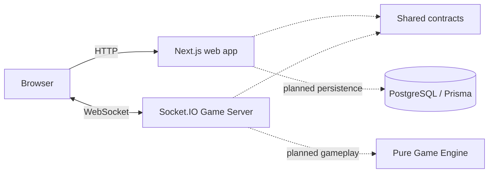

<div align="center">
  

  <h1>AptiQuiz</h1>
  <p><strong>Race the clock. Climb the room.</strong></p>
  <p>Live aptitude competition for students preparing for placements.</p>

  <p>
    <a href="LICENSE"></a>
    <a href="Apti-App/package.json"></a>
    <a href="Apti-App/package.json"></a>
    <a href="#project-status"></a>
  </p>

  <p>
    <a href="#quick-start">Quick start</a> ·
    <a href="Architecture.md">Architecture</a> ·
    <a href="https://github.com/codesuke/AptiQuiz/issues">Roadmap &amp; issues</a> ·
    <a href="CONTRIBUTING.md">Contributing</a>
  </p>

  <p>
    <a href="https://nextjs.org/"></a>
    <a href="https://react.dev/"></a>
    <a href="https://www.typescriptlang.org/"></a>
    <a href="https://tailwindcss.com/"></a>
    <a href="https://socket.io/"></a>
    <a href="https://www.postgresql.org/"></a>
    <a href="https://www.prisma.io/"></a>
    <a href="https://pnpm.io/"></a>
  </p>
</div>

## About

AptiQuiz turns solitary placement practice into a live competition. The intended experience brings students into a shared Room to answer synchronized aptitude Questions, build accuracy under pressure, and follow their progress on a Leaderboard.

Hosts will create reusable Question Sets and share a Join Code. Participants will compete from phones or laptops, with the Game Server controlling deadlines, answer acceptance, and scoring. Completed results will contribute to College Leagues.

Built for **hackathon problem statement 3 — AptiQuiz**. See [the official brief and build specification](PS.md) for the full product scope.

## Project status

**The application is under active development.** Accounts are implemented and the web app and Game Server are deployed on Dokploy. Both public HTTPS health endpoints responded on 2026-10-10. A complete multiplayer match and the 50-Participant proof remain unfinished; consult [build memory](docs/build-memory.yaml) for verified feature delivery. The home page links to Question Set authoring and hosting setup, and labels Room creation and joining as upcoming.

| Area | Current state |
| --- | --- |
| Web application | Next.js home page, AptiQuiz branding, health endpoint, and connection details |
| Realtime server | Long-running Socket.IO server with health checks and validated time-ping acknowledgements |
| Game Engine | Tested initial phase transitions and provisional scoring rules |
| Shared contracts | Zod validation and TypeScript types for current interfaces |
| Database | PostgreSQL/Prisma schema and generated client; product persistence still planned |
| Connection simulator | Verified 50 concurrent local connections and time-ping responses |
| Gameplay | Question Set authoring, Room joining, live answers, reveal, and Leaderboard still planned |
| Accounts & leagues | Core account flows implemented; reconnection, completed results, and College League still planned |

The simulator currently measures connectivity, not complete-match capacity. The latest recorded relocation check connected **50/50 clients**, with **11 ms median / 13 ms p95** local time-ping round trip. Results are environment-specific; see [build memory](docs/build-memory.yaml) for verification history and limitations.

## Quick start

### Prerequisites

- Node.js **22.18+**; Node.js 24 is recommended by the project setup.
- pnpm **11**; the workspace pins `11.24.0`.
- PostgreSQL for account flows, database migrations, and database browsing.

### Install and run

```bash
git clone https://github.com/codesuke/AptiQuiz.git
cd AptiQuiz/Apti-App
cp .env.example .env
pnpm install
```

All workspace commands run from **`Apti-App/`**. Installation generates the Prisma client. Create your local PostgreSQL database, update `DATABASE_URL` in `.env`, and configure the authentication variables needed by account flows before starting the application. Then run:

```bash
pnpm db:migrate
pnpm dev
```

| Service | Local URL |
| --- | --- |
| Web application | http://localhost:3000 |
| Web health | http://localhost:3000/api/health |
| Game Server health | http://localhost:3001/health |

The [environment template](Apti-App/.env.example) documents server ports, browser URLs, and reserved authentication settings. The Game Server reads `Apti-App/.env` and refuses to start unless `GAME_SERVER_SECRET` contains at least 32 characters; generate one with `openssl rand -base64 32`.

Google sign-in is optional. To enable it, create an OAuth client of type "Web application" in the Google Cloud console, add `http://localhost:3000/api/auth/callback/google` as an authorized redirect URI, and set `GOOGLE_CLIENT_ID` and `GOOGLE_CLIENT_SECRET` in `.env`. When either value is empty, the sign-in and sign-up pages show only the email form. Production redirect URIs are configured with the Dokploy deployment.

### Prepare Google SMTP for transactional email

The project includes a Gmail/Nodemailer sender configured through `GMAIL_USER` and `GMAIL_APP_PASSWORD`. **Email verification and password-reset callbacks have not yet been connected to Better Auth**, so these values do not send auth email by themselves today. Configure them now only when preparing a deployment or when wiring those callbacks.

1. Use a dedicated Gmail or Google Workspace sender mailbox.
2. Turn on [Google 2-Step Verification](https://support.google.com/mail/answer/185839).
3. Create an [App Password](https://myaccount.google.com/apppasswords) named `AptiQuiz SMTP` and copy the generated 16-character value.
4. Set the values in `Apti-App/.env`—never use the account's normal password or commit the file:

   ```env
   GMAIL_USER=aptiquiz.notifications@gmail.com
   GMAIL_APP_PASSWORD=your-16-character-google-app-password
   ```

Google may not offer App Passwords for Workspace accounts where an administrator disables them, accounts using Advanced Protection, or accounts configured only with security keys. Changing the Google account password revokes existing App Passwords; create and deploy a replacement when that happens. See [Google's App Password guidance](https://support.google.com/accounts/answer/185833).

### Verify the workspace

```bash
pnpm check
```

This runs formatting/lint checks, TypeScript checks, behavior tests, and production builds. Individual commands are also available:

| Command | Purpose |
| --- | --- |
| `pnpm lint` | Biome formatting and lint checks |
| `pnpm typecheck` | Strict TypeScript checks |
| `pnpm test` | Vitest behavior tests |
| `pnpm build` | Production builds for apps and packages |
| `pnpm simulate` | Concurrent Socket.IO connection and time-ping check |

Run `pnpm simulate` in another terminal while `pnpm dev` is running.

### Database commands

```bash
pnpm db:generate
pnpm db:migrate
pnpm db:studio
```

Migrations and Prisma Studio need a reachable PostgreSQL database and a valid `DATABASE_URL`. The schema lives in [packages/database](Apti-App/packages/database/prisma/schema.prisma).

## Architecture

The web interface and realtime runtime share validated contracts and deterministic game rules. A separate Game Server owns timing; the browser is not authoritative for answers or scores.



Solid arrows show current browser interfaces. Dashed arrows show shared dependencies or planned integration, as labeled. The Game Engine and database schema exist; complete gameplay and persistence flows remain to be wired.

```text
AptiQuiz/
├── Apti-App/                 # Runnable pnpm / Turborepo workspace
│   ├── apps/
│   │   ├── web/              # Next.js interface and public brand assets
│   │   ├── game-server/      # Authoritative Socket.IO runtime
│   │   └── simulator/        # Repeatable connection verification
│   └── packages/
│       ├── contracts/        # Runtime schemas and transport types
│       ├── game-engine/      # Pure phase transitions and scoring
│       ├── database/         # Prisma schema and PostgreSQL adapter
│       └── typescript-config/
├── design-mocks/             # UI references, prototypes, and logo provenance
├── docs/                     # Architecture decisions and build records
└── AGENTS.md                 # Agent contribution rules
```

Read [Architecture.md](Architecture.md) for implemented interfaces, failure behavior, and deployment plans. Redis remains deferred until measurements justify multiple Game Server processes; Kafka is also deferred.

## Scoring and timing

The Game Server is the only clock that decides an Answer. Players see these rules in the Lobby before the match starts.

- **Round length.** Each Question stays open for 30 s from its server start time.
- **Points.** A correct Answer earns `500 + floor(500 × (1 − Effective Response Time / duration))`, so 500 to 1000 points; faster earns more. A wrong or missing Answer earns 0. Only the first accepted Answer counts.
- **Network delay.** The Game Server pings each connection and keeps a rolling median of the measured round-trip times. For scoring, it subtracts `min(median RTT / 2, 100 ms)` from the elapsed time, or 0 when there is no valid sample yet.
- **Buckets.** The Effective Response Time is rounded down to 100 ms steps before the formula, so tiny timing differences do not change the score.
- **Deadline.** There is no grace period. An Answer that the server receives after the deadline is rejected; delay compensation only affects the score of an on-time Answer and never makes a late Answer valid.

The values are configured in [`Apti-App/apps/game-server/src/config.ts`](Apti-App/apps/game-server/src/config.ts) and sent to the browser with the Lobby, so the shown rules always match the server.

## Tech stack

<div align="center">
  <a href="https://nextjs.org/"></a>
  <a href="https://react.dev/"></a>
  <a href="https://www.typescriptlang.org/"></a>
  <a href="https://tailwindcss.com/"></a>
  <a href="https://nodejs.org/"></a>
  <a href="https://socket.io/"></a>
  <a href="https://www.postgresql.org/"></a>
  <a href="https://www.prisma.io/"></a>
  <a href="https://pnpm.io/"></a>
  <a href="https://turbo.build/"></a>
  <a href="https://biomejs.dev/"></a>
  <a href="https://vitest.dev/"></a>
</div>

<p align="center"><sub>Next.js · React · TypeScript · Tailwind CSS · Node.js · Socket.IO · PostgreSQL · Prisma · pnpm · Turborepo · Biome · Vitest</sub></p>

| Arena | Stack |
| --- | --- |
| Player experience | Next.js 16, React 19, Tailwind CSS 4 |
| Live competition | Node.js, Socket.IO 4, authoritative Game Server |
| Shared rules | TypeScript, Zod, pure Game Engine |
| Persistence | PostgreSQL, Prisma ORM 7 |
| Monorepo & quality | pnpm 11, Turborepo, Biome, Vitest |

Better Auth integration and the Dokploy deployment are present; remaining deployment acceptance checks are tracked in [issue #11](https://github.com/codesuke/AptiQuiz/issues/11). Exact dependency versions are recorded in [the workspace](Apti-App/package.json) and [lockfile](Apti-App/pnpm-lock.yaml).

## Roadmap

The active roadmap and acceptance criteria live in [GitHub Issues](https://github.com/codesuke/AptiQuiz/issues).

1. Build minimal College selection and Question Set authoring, including optional image and table content.
2. Complete the Room, live Round, Guest entry, and Participant reconnection flows.
3. Show Leaderboard movement and final results, then aggregate one weekly College League.
4. Verify a complete 50-Participant match against the existing deployment and document the evidence.

## Documentation

| Resource | Contents |
| --- | --- |
| [Product brief](PS.md) | Official problem statement and product scope |
| [Domain glossary](CONTEXT.md) | Question Sets, Rooms, Rounds, and other shared terms |
| [Architecture](Architecture.md) | System structure, implemented behavior, and accepted plans |
| [Architecture decisions](docs/ADR/README.md) | Recorded technical trade-offs |
| [Brand](Brand.md) · [Design system](DESIGN.md) | Logo usage, voice, palette, and interface direction |
| [Design references](design-mocks/README.md) | Authentication prototype and generated asset provenance |
| [Deployment guides](docs/guide/README.md) | Dokploy deployment, DNS records, and nameserver delegation |
| [Build memory](docs/build-memory.yaml) | Verified changes, evidence, and known limitations |

## Contributing

Bug reports, documentation improvements, and focused contributions are welcome. Read [CONTRIBUTING.md](CONTRIBUTING.md) for setup, verification, and the GitHub-first delivery workflow. AI agents should also follow [AGENTS.md](AGENTS.md).

Open an [issue](https://github.com/codesuke/AptiQuiz/issues) to discuss a feature or report a reproducible bug. Keep contributions small and name the observable behavior they change.

## Acknowledgements

OpenAI Codex assisted with architecture, bootstrap code, and documentation. The AptiQuiz logo was generated with the built-in imagegen tool; its [original prompt and asset](design-mocks/aptiquiz-logo/README.md) are preserved. The current product has no end-user AI feature.

## License

Licensed under the [MIT License](LICENSE). Copyright © 2026 Codesuke.
